<div align="center">

# 🏢 Full Stack Company Dashboard

**A full-stack organization management app for departments, managers and employees — with live analytics.**


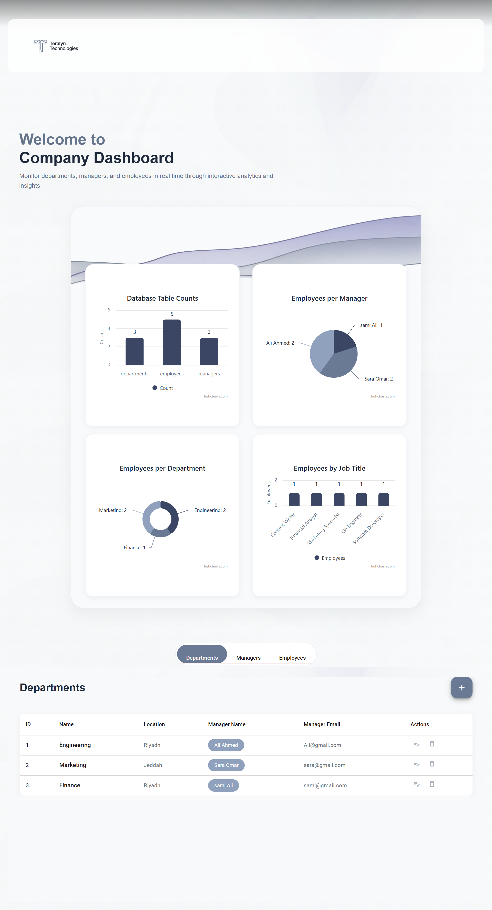

</div>

---

## 📖 Table of Contents

- [About the Project](#-about-the-project)
- [Features](#-features)
- [Screenshots](#-screenshots)
- [Tech Stack](#-tech-stack)
- [REST API](#-rest-api)
- [Data Model](#-data-model)
- [Validation & Business Rules](#-validation--business-rules)
- [Getting Started](#-getting-started)
- [Available Scripts](#-available-scripts)
- [Project Structure](#-project-structure)
- [Roadmap](#-roadmap)
- [Author](#-author)

---

## 🚀 About the Project

**Full Stack Company Dashboard** is a web application for managing a company's organizational structure. It lets you create, view, edit and delete **departments**, **managers** and **employees**, while a real-time analytics dashboard turns the data into charts.

The project was built during a cooperative training program and consists of:

- **Backend** — a Spring Boot (Java 21) application using Spring Data JPA, Querydsl and MapStruct to expose a RESTful API, backed by an H2 database.
- **Frontend** — an Angular 21 application with Angular Material, Highcharts, toast notifications and SSR support.

> The dashboard is branded for the fictional company **Teralyn Technologies** and ships with a small sample data set (3 departments, 3 managers, 5 employees).

---

## ✨ Features

- 📊 **Interactive analytics dashboard** powered by Highcharts
  - Database table counts
  - Employees per manager
  - Employees per department
  - Employees by job title
- 🗂️ **Three management sections** switchable from a pill-style tab bar: **Departments**, **Managers**, **Employees**
- ➕ **Create / ✏️ Edit / 🗑️ Delete** records through a slide-in side form
- ✅ **Client-side form validation** with clear inline error messages
- 🔗 **Business-rule enforcement** — an employee's manager must belong to the employee's department
- 🔔 **Toast notifications** for server-side errors
- 🎨 **Polished UI** — rounded cards, avatar initials, manager "chips", and a calm slate/indigo palette
- 🖥️ **SSR-ready** Angular setup (`@angular/ssr` + Express)

---

## 📸 Screenshots

### Dashboard

The landing page greets the user and shows four live charts. The tabs below it switch between the data tables.

<div align="center">
  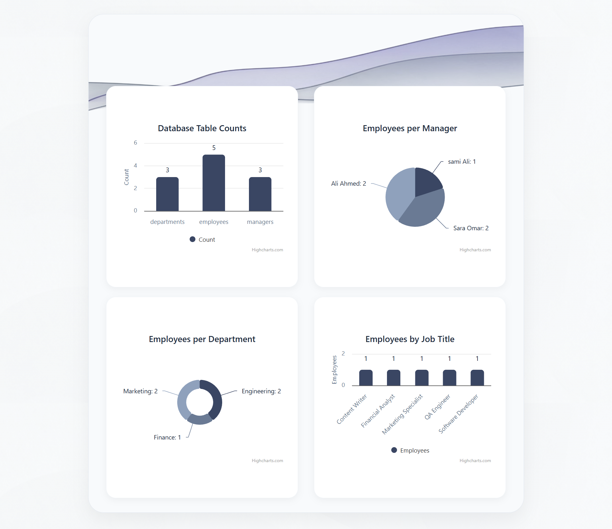
  <br/><sub><b>Analytics close-up</b> — table counts, employees per manager, per department and by job title</sub>
</div>

### Departments

| List | Add form |
|:---:|:---:|
| 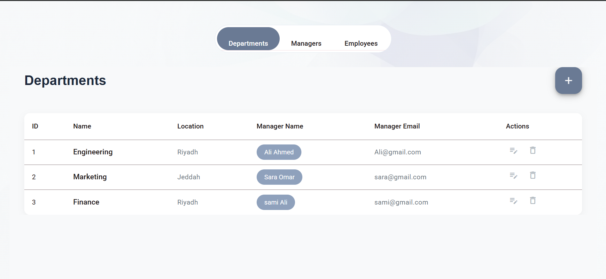 | 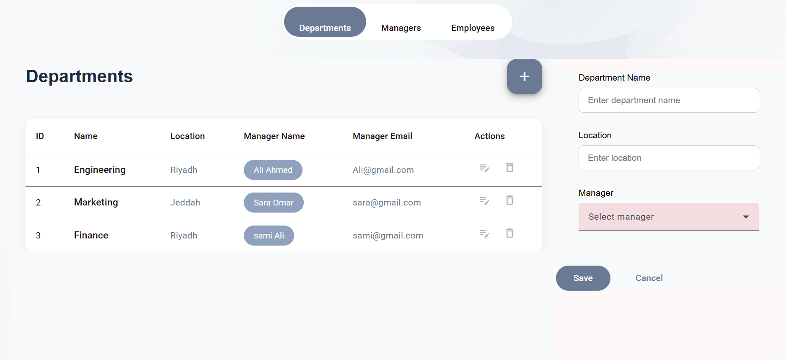 |
| **Departments table** with manager chip and email | **Add department** — side panel opens next to the table |

| Validation | Manager dropdown | Edit form |
|:---:|:---:|:---:|
| 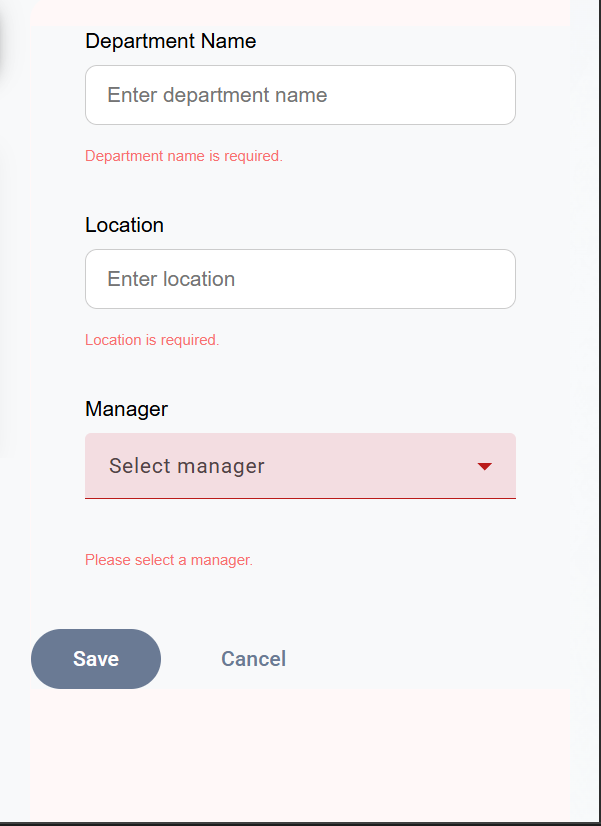 | 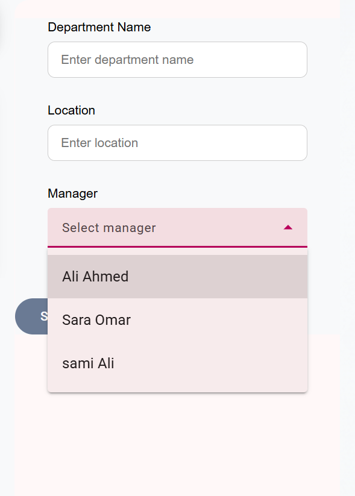 | 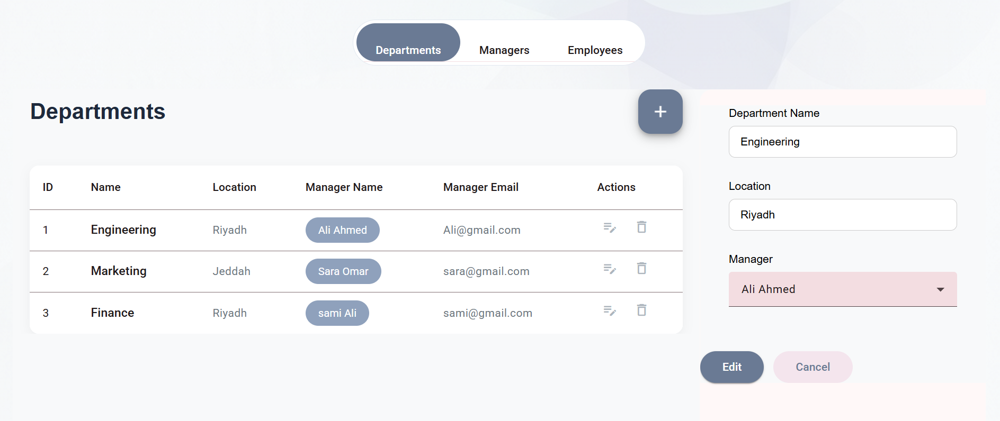 |
| Required-field errors | Pick an existing manager | Pre-filled form with an **Edit** button |

### Managers

| List | Add form |
|:---:|:---:|
| 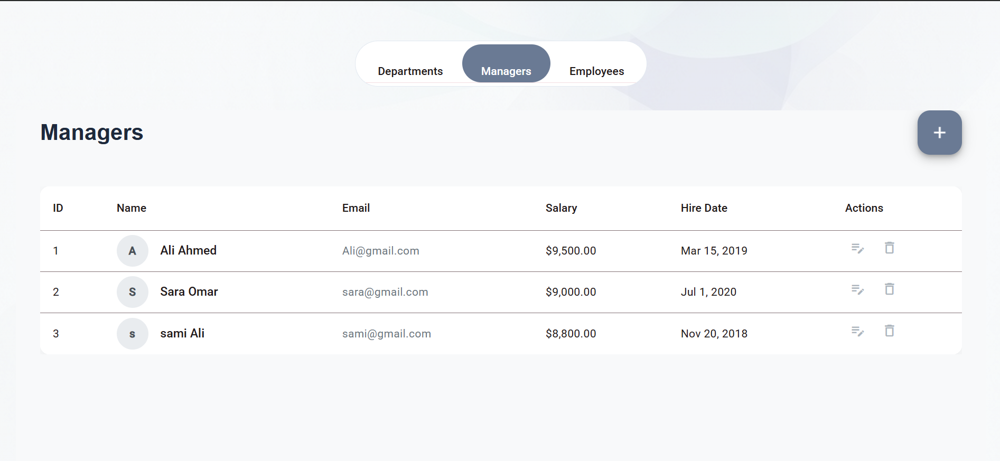 | 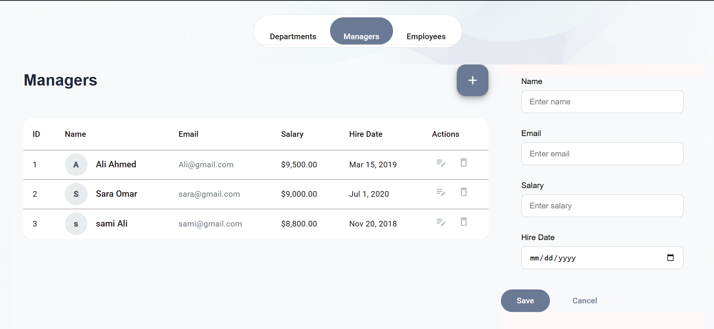 |
| **Managers table** with avatar, salary and hire date | **Add manager** form |

| Validation | Date picker | Invalid email | Edit form |
|:---:|:---:|:---:|:---:|
| 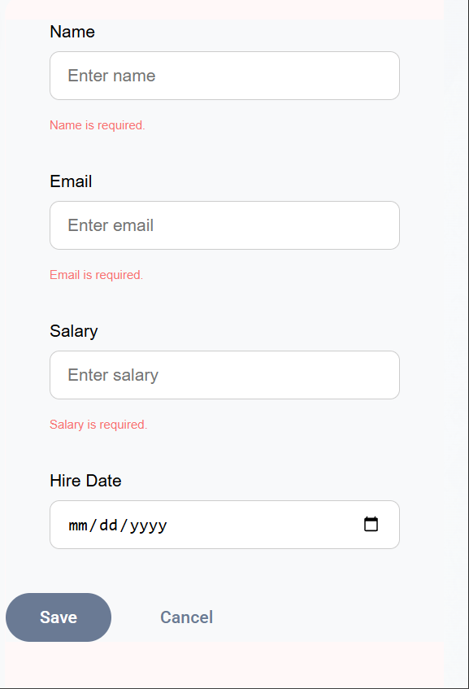 | 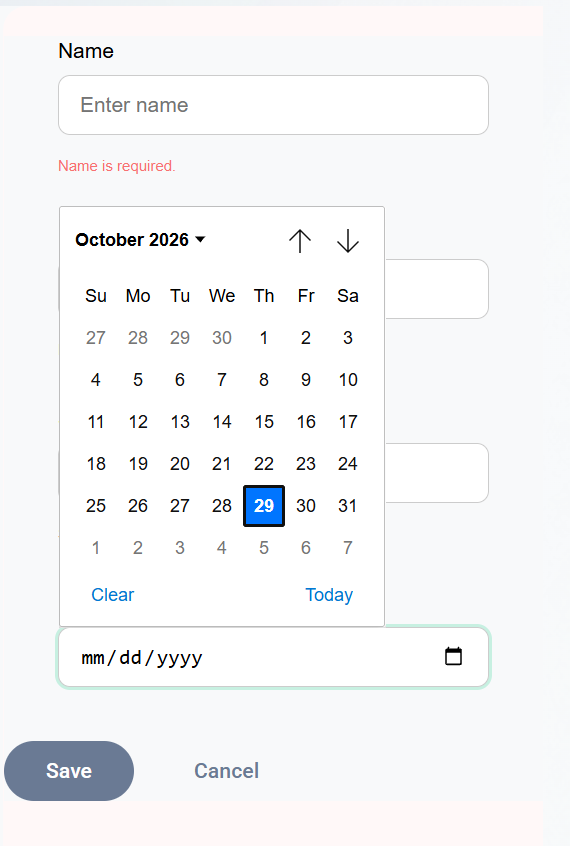 | 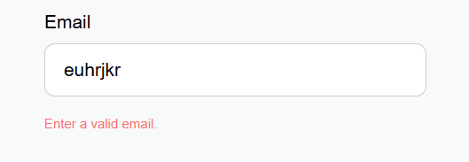 | 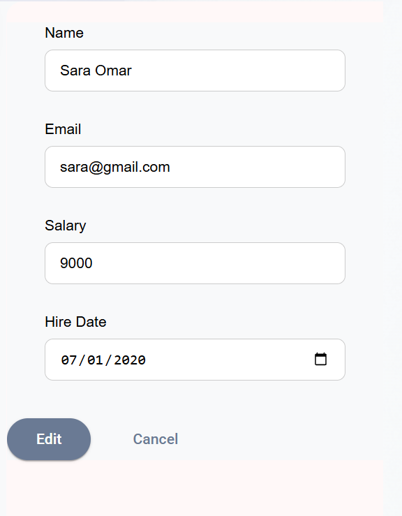 |
| Required fields | Native hire-date picker | Email format check | Pre-filled edit |

### Employees

<div align="center">
  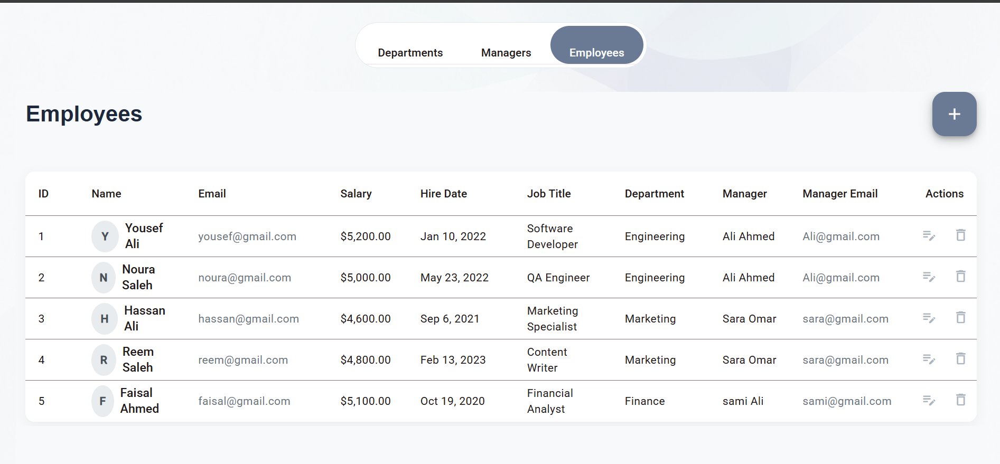
  <br/><sub><b>Employees table</b> — job title, department, manager and manager email at a glance</sub>
</div>

<br/>

| Form (top) | Form (bottom) | Validation |
|:---:|:---:|:---:|
| 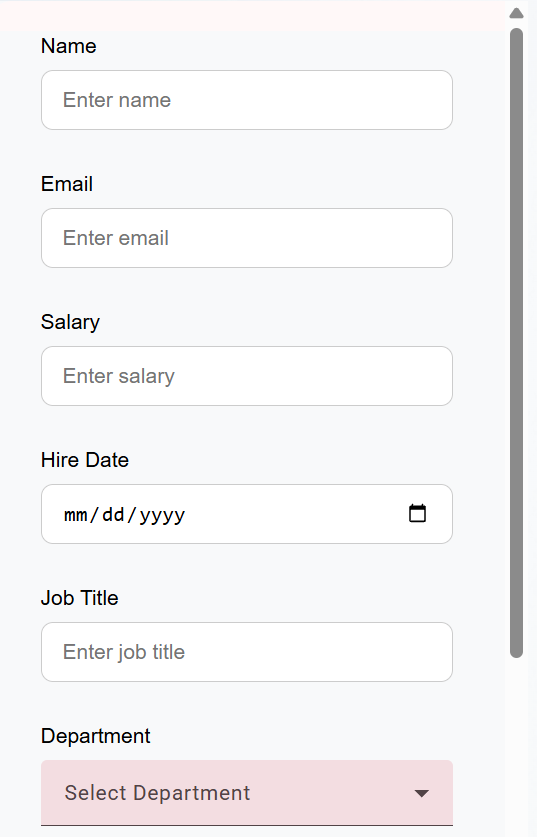 | 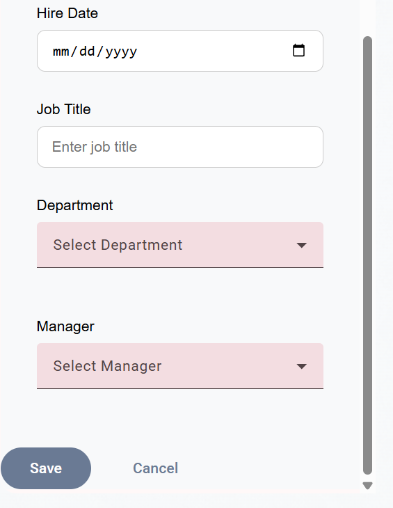 | 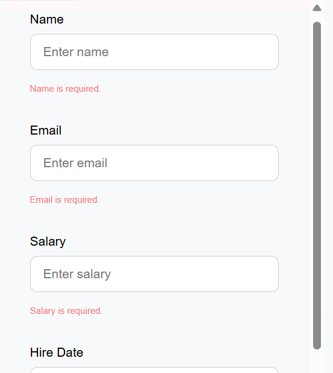 |
| Name, email, salary, hire date, job title, department | Department & manager selection | Inline required-field errors |

| Department dropdown | Manager dropdown |
|:---:|:---:|
| 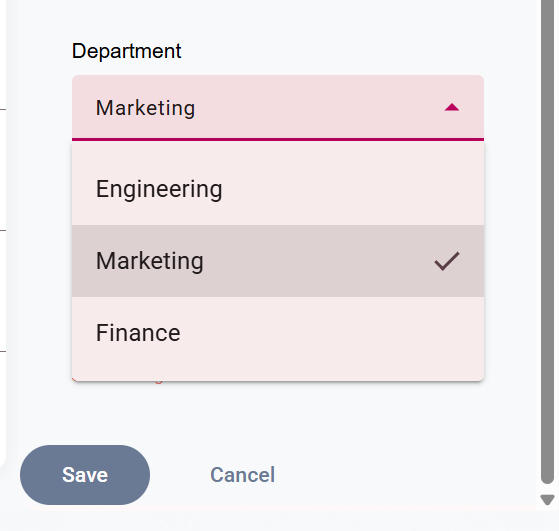 | 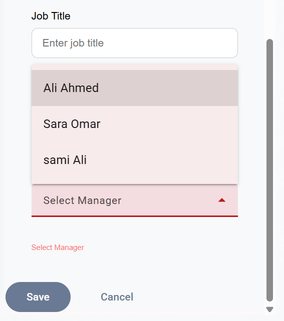 |

### ⚠️ Department / Manager Mismatch

If the selected manager does not belong to the selected department, the server rejects the request, an error toast is shown, the form closes and the employee is **not** added.

<div align="center">
  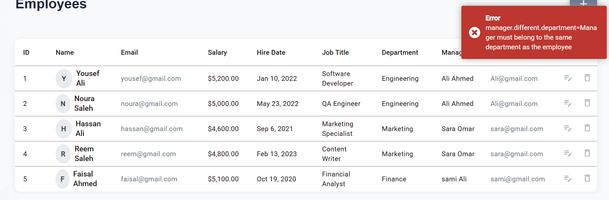
</div>

---

## 🧰 Tech Stack

### Backend

| Category | Technology |
|---|---|
| Language | Java 21 |
| Framework | Spring Boot 4.0.2 |
| Persistence | Spring Data JPA, H2 (runtime) with H2 console |
| Querying | Querydsl 5.0.0 (Jakarta) |
| API | Spring Web (REST controllers) with a global exception handler (`@RestControllerAdvice`) |
| Mapping | MapStruct 1.5.5.Final |
| Boilerplate | Lombok |
| Validation | Jakarta Validation 3.1.1 |
| Build | Maven |
| Testing | spring-boot-starter-test |

### Frontend

| Category | Technology |
|---|---|
| Framework | Angular 21 (standalone, SSR via `@angular/ssr`) |
| UI | Angular Material & CDK |
| Charts | Highcharts 12.5 + `highcharts-angular` 5.4 |
| Notifications | ngx-toastr |
| Reactive | RxJS 7.8 |
| Server | Express 5 (SSR) |
| Language | TypeScript 5.9 |
| Testing | Vitest + jsdom |

---

## 🔌 REST API

The backend exposes a RESTful API built with Spring `@RestController` classes, following a **Controller → Service → Repository** architecture, and was tested with **Postman**.

| Controller | Purpose |
|---|---|
| `DepartmentController` | CRUD operations for departments |
| `ManagerController` | CRUD operations for managers |
| `EmployeeController` | CRUD operations for employees |
| `TableCountsController` | Data for the *Database Table Counts* chart |
| `EmployeesPerManagerController` | Data for the *Employees per Manager* chart |
| `EmployeesPerDepartmentController` | Data for the *Employees per Department* chart |
| `EmployeesByJobTitleController` | Data for the *Employees by Job Title* chart |

Errors are handled centrally by a `GlobalExceptionHandler` (`@RestControllerAdvice`). The Angular app catches them in an HTTP interceptor and shows them as toast notifications.

---

## 🗃️ Data Model

```
┌──────────────┐        ┌──────────────┐        ┌──────────────────┐
│   Manager    │ 1    1 │  Department  │ 1    * │     Employee     │
│──────────────│◄───────│──────────────│◄───────│──────────────────│
│ id           │        │ id           │        │ id               │
│ name         │        │ name         │        │ name             │
│ email        │        │ location     │        │ email            │
│ salary       │        │ manager      │        │ salary           │
│ hireDate     │        └──────────────┘        │ hireDate         │
└──────────────┘                                │ jobTitle         │
        ▲                                       │ department       │
        └───────────────────────────────────────│ manager          │
                       1    *                   └──────────────────┘
```

- A **department** is led by one **manager**.
- An **employee** belongs to one **department** and reports to one **manager**.
- The employee's manager **must be** the manager of the employee's department.

---

## 🛡️ Validation & Business Rules

| # | Rule | Behavior |
|:-:|---|---|
| 1 | **Required fields** | If a required field is left empty, the data is **not saved or submitted** and an inline error is shown. |
| 2 | **Valid email** | The email must be well-formed (e.g. `name@example.com`), otherwise the form cannot be submitted (*"Enter a valid email."*). |
| 3 | **Numeric salary** | The salary field accepts **numbers only** — typing letters or symbols writes nothing. |
| 4 | **No duplicates** | Duplicate data is **not allowed** and will not be submitted. |
| 5 | **Employee ↔ Manager ↔ Department match** | When adding an employee you must choose a **department** and a **manager**. If the manager does not belong to that department, an error message appears, the form closes, and the employee is **not** added. |

---

## ⚡ Getting Started

### Prerequisites

- **Java 21+**
- **Maven 3.9+** (or use the Maven wrapper if included)
- **Node.js 20+** and **npm 11** (the project declares `npm@11.9.0`)
- *(Optional)* **Postman** or any HTTP client to test the API directly

### 1. Clone the repository

Clone this repository and open it in your terminal.

### 2. Run the backend

From the backend project folder (the one containing `pom.xml`):

```bash
mvn clean install
mvn spring-boot:run
```

The API starts on Spring Boot's default port (`http://localhost:8080`) unless you changed it in `application.properties`. Since H2 and its console are included, you can inspect the in-memory database from the H2 console while the app is running.

> Querydsl `Q*` classes are generated at build time into `target/generated-sources`. If your IDE reports missing `Q` classes, run `mvn clean compile` and mark that folder as a generated sources root.

### 3. Run the frontend

From the frontend project folder (the one containing the Angular `package.json`):

```bash
npm install
npm start
```

Open **http://localhost:4200** — the dashboard loads and talks to the backend.

> Make sure the backend is running first, otherwise the charts and tables will be empty.

---

## 📜 Available Scripts

### Frontend

| Command | Description |
|---|---|
| `npm start` | Start the dev server (`ng serve`) |
| `npm run build` | Production build |
| `npm run watch` | Rebuild on changes (development configuration) |
| `npm test` | Run unit tests (Vitest) |
| `npm run serve:ssr:welcome-project` | Serve the built SSR bundle with Node |

### Backend

| Command | Description |
|---|---|
| `mvn spring-boot:run` | Run the application |
| `mvn clean install` | Build and run tests |
| `mvn test` | Run tests only |

---

## 📁 Project Structure

```
.
├── Backend project           # Spring Boot application (contains pom.xml)
│   ├── src/main/java/...     # entities, repositories (Querydsl), services, API layer, exception handling
│   └── src/main/resources/   # configuration and seed data
│
├── Frontend project          # Angular application (contains package.json)
│   └── src/app/              # dashboard, departments, managers, employees
│
├── docs/
│   └── screenshots/          # images used in this README
└── README.md
```

---

## 🗺️ Roadmap

- [ ] Authentication & role-based access
- [ ] Search, sorting and pagination in tables
- [ ] Persistent database (PostgreSQL / MySQL) instead of in-memory H2
- [ ] Docker Compose setup for one-command startup
- [ ] Unit and end-to-end test coverage
- [ ] Export data to CSV / Excel

---

## 👤 Author

**Alanoud Almoisheer**

The project was supervised and guided by internship mentors (a back-end software developer and a front-end software developer) at **Saudi Telecom Company (STC)** during the cooperative training program.

---

<div align="center">

⭐ If you found this project useful, consider giving it a star!

</div>
